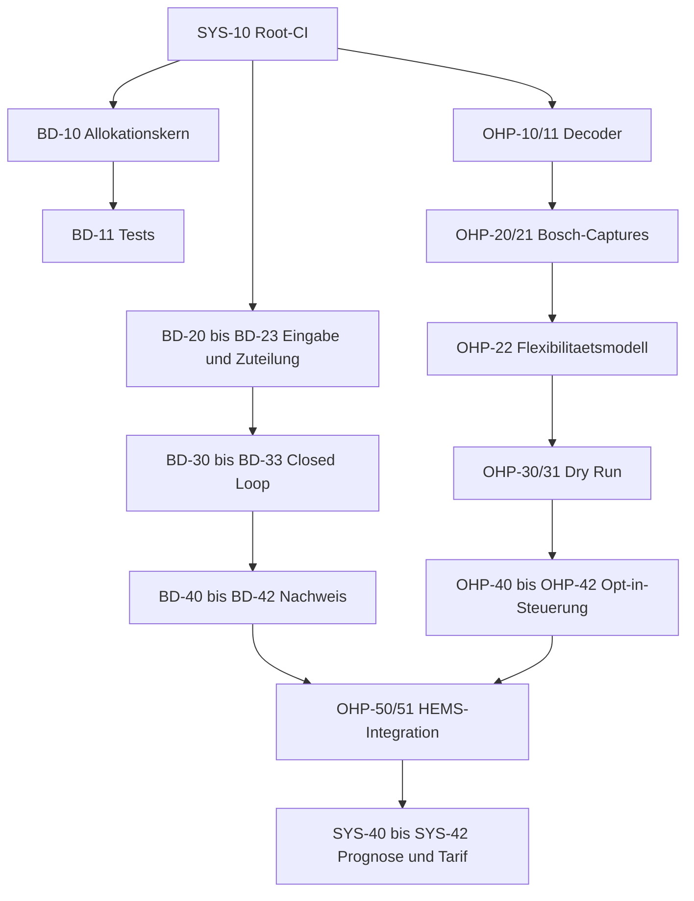

# Entwicklungs-TODO

Stand: 2026-10-18

Diese Datei ist die zentrale Status- und Reihenfolgenliste. Fachliche
Begruendung und Abnahmekriterien stehen in den verlinkten Konzeptdokumenten.

## Arbeitsweise

- `[ ]` offen, `[x]` abgeschlossen.
- Es wird immer die oberste nicht blockierte Aufgabe aus "Naechste Aufgaben"
  bearbeitet.
- Eine Aufgabe gilt erst als abgeschlossen, wenn ihre Tests und die Abnahme
  im zugehoerigen Konzept erfuellt sind.
- Blockaden werden direkt an der Aufgabe mit Grund und benoetigter
  Entscheidung dokumentiert.
- Bei Abschluss werden Datum und kurzer Verweis auf Commit, Testprotokoll oder
  Capture ergaenzt. Die ID bleibt dauerhaft bestehen.
- Neue Aufgaben erhalten eine ID ihres Themenbereichs und werden zuerst im
  zugehoerigen Konzept beschrieben.

## Naechste Aufgaben

1. **SYS-15** Verbleibende Hardware-Regressionen der bereits integrierten
  OpenEEBus-Aktualisierung abschliessen. Gepinnter Stand bleibt `f714766`;
  weitere Upstream-PRs sind dadurch nicht automatisch uebernommen.
2. **BD-24** Xemex-Optimierung und CSMB-Hardwareabnahme abschliessen.
  Der 6-kW-Test vom 2026-10-07 verfehlte die Abnahmekriterien. Historische
  Testfreigaben sind keine Freigabe fuer neue Live-Eingriffe.
3. **SYS-16** Bestehende Upstream-Beitraege nachverfolgen und weitere
  belegte Kandidaten pruefen; keine Doppelbeitraege erstellen.
4. **BD-23** EV und Wallbox auf reale Leistungsstufen quantisieren.
5. **OHP-20** Fehlende Zustaende der Bosch-Capture-Matrix sowie automatische
  Subscription und Binding am Geraet gezielt pruefen; neue Live-Freigabe erforderlich.
6. **OHP-21** Bosch-Einheiten, Zeiten und State-Transitions dokumentieren.

## Systemarchitektur

Konzept: [Zielarchitektur und Entwicklungsplan](docs/system-architecture.md)

- [x] **SYS-17** HEMS-UI-Diagnose inventarisiert und bereinigt
  (aufgenommen und umgesetzt 2026-10-18, auf Benutzerwunsch vorgezogen).
  Sechs UI-Elemente entfernt: drei abgeschlossene K40RF-Testelemente,
  doppelte §14a-Kanalanzeige, Grid-Charge-Rohwert und Ladezustands-Rohanzeige.
  Ladezustand bleibt intern fuer den Regler; Testskript, Testzustand und
  exklusiver ACK-Getter entfernt. Doppelte Heartbeat-Auswertung und reine
  MPC-Log-Automationen entfernt. Inventar/Begruendung im Architekturkonzept.
  3/3 Hosttests und Firmware-Build `2026-10-18 11:45:40 +0200` bestanden.
  Produktive Steuerungs-/Schutzlogik erhalten; kein OTA, keine Live-Abnahme.

- [x] **SYS-00** Zielarchitektur und Entwicklungsplaene dokumentiert
  (2026-07-13).
- [x] **SYS-01** Zentrale TODO-Liste angelegt (2026-07-13).
- [x] **SYS-10** Root-CI fuer ESPHome, Python, Host-Tests und Submodule
  eingerichtet (2026-07-19). Der Workflow prueft Python-Syntax und
  Abhaengigkeiten, kompiliert die ESPHome-Firmware mit CI-Secrets und fuehrt die
  CMake/CTest-Host-Tests mit rekursivem Submodule-Checkout aus. actionlint,
  `compileall`, Host-Tests und vollstaendiger Firmware-Compile sind lokal gruen.
  Seit 2026-10-16 ist zusaetzlich `eebus-minimal.yaml` mit eigener CI enthalten;
  der lokale Docker-Build mit ESPHome 2026.5.3 bestand. Das belegt keine
  Hardwarekompatibilitaet ausserhalb der dokumentierten Referenzplattform.
- [x] **SYS-11** Gemeinsames CMake/CTest-Host-Testziel fuer Regelkern und
  Fixtures bereitgestellt (2026-07-13).
- [ ] **SYS-12** Fake-Steuerbox/-Wallbox in reproduzierbare Szenariotests
  integrieren.
- [x] **SYS-13** Lokale OpenEEBUS-Toolchain vervollstaendigt und beide
  PR-Worktrees validiert (2026-07-19): CMake, Ninja, clang-format 18/22, MSVC
  Build Tools mit MFC/ATL, Windows SDK, vcpkg, Bonjour/mdnsresponder und GTest
  installiert. PR #43 und #44 bestehen den clang-format-18-Diffcheck, lokale
  MSVC-Builds sowie die vollstaendige Ubuntu-24.04-CMake/CTest-Suite. Beide
  Branches wurden auf `upstream/main` rebasiert und per `--force-with-lease`
  aktualisiert.
- [x] **SYS-14** Lokale Entwicklungs- und Validierungsumgebung stabilisiert
  (2026-08-15): VS-Code-Tasks starten profilfreie PowerShell-Prozesse und
  loesen Git, Docker, Python und ESPHome ueber `PATH` oder bekannte
  Installationsorte auf. Wrapper protokollieren Start, Laufzeit und Exit-Code;
  OpenEEBus-Ausgaben bleiben durch kompakte Erfolgslogs auswertbar. Frische
  Task-Sitzungen bestanden Umgebungspruefung, ESPHome-Compile, Host-CTest
  (1/1) und OpenEEBus-CTest (674/674).
- [ ] **SYS-15** OpenEEBus auf den aktuellen Upstream-Stand bringen, lokale
  Anpassungen abgleichen und unsere HEMS-Funktionalitaet erhalten. OpenEEBus-
  und HEMS-Tests, ESPHome-Build sowie CS/EG-, LPC-, OSSHPCF- und
  Reconnect-Regressionen pruefen; geprueften Submodul-Commit und Rollback-Stand
  dokumentieren (aufgenommen 2026-10-06).
  Lokale Integration am 2026-10-07: Upstream `c31acf5` eingearbeitet,
  Merge-Konflikte aufgeloest; 833/833 OpenEEBus- und 2/2 HEMS-Host-Tests,
  acht Offline-Wallbox-Fixtures sowie ESPHome-Clean-Build bestanden.
  32/32 Software-Integrationstests bestanden, einschliesslich 20 SIMOPEN-
  Durchlaeufen, drei Drei-Geraete-Stresslaeufen und drei Shutdown-Pruefungen.
  Merge `89ee840` plus ESP-IDF-Headerfix `f714766` im Hauptrepository gepinnt.
  Integrationsfix `d643778` behebt fehlende Listener-Callbacks nach Bosch-Discovery;
  GitHub-CI gruen, OTA-Build `Oct 7 2026 10:56:20` live mit Bosch verbunden.
  Vollstaendige Hardwareabnahme noch offen. Details und Rollback:
  Systemarchitektur, Integrationsstand.
- [ ] **SYS-16** Aus den Erkenntnissen geeignete OpenEEBus-Upstream-PRs
  ableiten und erstellen, sofern ein allgemein nutzbarer, belegter Beitrag
  verbleibt. Aktuelle CONTRIBUTING-/Maintainer-Regeln, PR-Vorlagen,
  Formatierung und CI beachten; bestehende Beitraege auf Doppelung pruefen.
  Reproduktion, Regressionstests und klare Testnachweise beilegen. PR-Links
  oder begruendete Nicht-Eignung dokumentieren (aufgenommen 2026-10-07).
  Am 2026-10-07 zwei isolierte Draft-PRs gegen `NIBEGroup/openeebus:main`
  (`c31acf5`) erstellt: [#71 ESP-IDF-cJSON-Headerfix](https://github.com/NIBEGroup/openeebus/pull/71)
  und [#72 eindeutiger EV-Demo-mDNS-Name](https://github.com/NIBEGroup/openeebus/pull/72).
  Beide bestehen den originalen `format_diff.sh`-Check mit clang-format 18.1.3.
  #71: Linux-/ESP_PLATFORM-Syntaxchecks; #72: vollstaendiger Linux-Debug-Build.
  Vorherige Fork-Integrationstests sind in den PRs getrennt als solche benannt.
  Pairing-Abbruch ist bereits Gegenstand von [#56](https://github.com/NIBEGroup/openeebus/pull/56),
  daher kein doppelter PR. Heartbeat-Sendemarge bleibt ein offener Kandidat;
  bestehende Heartbeat-Beitraege und Maintainer-Rueckmeldungen vorher abgleichen.
  Review 2026-10-17: citolens OHPCF-PRs #75 bis #78 bilden eine aufeinander
  aufbauende Kette, #78 ist Draft. Code und Tests gelesen, nicht lokal
  ausgefuehrt oder integriert; Details im Bosch-Konzept.
- [ ] **SYS-20** Systemzustaende normal/limited/degraded/failsafe definieren.
- [ ] **SYS-21** Strukturierte Betriebs- und Regeldiagnose bereitstellen.
- [ ] **SYS-22** Betreiberkonfiguration gegen Geraetefaehigkeiten validieren.
- [ ] **SYS-30** Netzwerk- und Zugangs-Bedrohungsmodell dokumentieren.
- [ ] **SYS-31** Webserver und MQTT absichern oder deaktivieren.
- [ ] **SYS-32** Update-, Backup- und Recovery-Verfahren testen.
- [ ] **SYS-40** Prognoseschnittstelle mit Unsicherheit definieren.
- [ ] **SYS-41** Eigenverbrauchsoptimierung im Dry Run bewerten.
- [ ] **SYS-42** Optional dynamische Tarife nachrangig integrieren.

## §14a-Budgetverteilung

Konzept: [§14a-Leistungsbudget-Verteilung](docs/power-distribution-concept.md)

- [x] **BD-00** Prioritaetsverteiler fuer EG1, EV und EG2 implementiert.
- [x] **BD-01** `min_limit_w` und Fremdgeraete-Guard implementiert.
- [ ] **BD-10** Testbaren Allokationskern aus YAML extrahieren; vorerst bewusst
  zurueckgestellt, die Verteilung bleibt in der ESPHome-Lambda.
- [ ] **BD-11** Allokationskern nach einer spaeteren Extraktion mit Host-Tests
  absichern.
- [x] **BD-20** Alter und Qualitaet der Budgeteingänge ausgewertet
  (2026-07-19): Solar- und Hausleistung verwenden echte Quellzeitstempel von
  HTTP/Modbus, maximal 10 s Alter sowie Finite-/Bereichspruefungen. Ungueltige
  oder alte Zusatzdaten erhoehen das VNB-Budget nie; ein ungueltiges Basislimit
  ergibt konservativ 0 W Gesamtbudget. Die Pruefung bleibt vorerst direkt in
  der ESPHome-Lambda.
- [x] **BD-21** Batterieentladung korrekt und konservativ saldiert
  (2026-07-19): Positive `Battery Power` bedeutet Entladung und erhoeht zusammen
  mit PV den Erzeugungsueberschuss; Laden sowie alte, fehlende, nicht-finite
  oder unplausible Batteriewerte zaehlen als 0 W Zusatzleistung. Beide
  Rohregister tragen echte 10-s-Quellzeitstempel und Wertebereichspruefungen.
- [ ] **BD-22** Atomare Mindestleistung bis zum Geraeteadapter absichern.
  Die Lambda weist bei unzureichendem Sockelbudget bereits rechnerisch 0 W zu.
  Codeabgleich 2026-10-17: EG sendet dafuer 1 W, weil `set_limit(0)` das
  Limit loescht; `min_limit_w` kann 1 W anschliessend auf 4200 W anheben.
  Auch positive Sockel unterhalb des Adapterminimums sind abzugleichen.
  End-to-End-Budgettreue und physischer Stopppfad sind daher noch offen.
- [ ] **BD-23** EV und Wallbox auf reale Leistungsstufen quantisieren.
- [ ] **BD-24** Stromverlaeufe der Wallbox auswerten und das CSMB-Regelkonzept
  bei Bedarf auf eine feine, schwingungsarme Steuerung ueberarbeiten. Als
  Referenz die bewaehrte Umsetzung in
  [thomase1234/esphome-fake-xemex-csmb](https://github.com/thomase1234/esphome-fake-xemex-csmb)
  heranziehen. Anschliessend erneut am realen Geraet messen, den Leistungssollwert
  mehrfach variieren und den Zyklus aus Auswertung, Anpassung und Test bei Bedarf
  wiederholen. Messbefund, Regelgesetz und Hardware-Abnahme stehen in
  [Xemex CSMB EV-Regelung](docs/xemex-control.md).
  Messung 2026-10-07 nach OTA: keine Ladepause bei 11,5 -> 6 kW, aber
  Zielband erst nach etwa 88 s und nur 76 % der letzten 120 s im Zielband.
  Einschwing- und Zielbandkriterien nicht bestanden; Kalibrierung unveraendert.
- [x] **BD-25** K40RF an der realen Waermepumpe mit §14a-Limits unter 4.200 W
  getestet (2026-07-20). 4.200 W wurden per LPC ACK bestaetigt; 4.000, 3.600,
  3.200, 2.800, 2.400 und 2.000 W blieben jeweils 15 s ohne ACK bei stabiler
  Verbindung. Damit bleibt 4.200 W die technische Mindestleistung; das Szenario
  `6.000 W Wallbox + 2.400 W Waermepumpe` ist mit K40RF nicht umsetzbar.
  Captures: `private/captures/k40rf-low-limits-20260720.csv` und
  `private/captures/k40rf-4200-ack-20260720.csv`.
- [ ] **BD-30** Aktive Limits spaetestens alle 60 Sekunden neu senden.
- [ ] **BD-31** Requested/acknowledged/measured je Verbraucher verfolgen.
- [ ] **BD-32** Closed-Loop-Compliance-Waechter implementieren.
- [ ] **BD-33** Degradierung, Failsafe und Reconnect deterministisch machen.
  Storage-Schutzpause und regulaere EV-Freigabesperre sind keine pauschale
  Geraetestoerung. Seit OTA 2026-10-18, Live-Build 20:58:39, nennt die
  Diagnose Zeitpunkt, Transaktionsphase bzw. Soll-/Ist-Ruecklesewerte.
  Mitschnitt 22:47 am 2026-10-18 nennt fuer die Pause um 21:23:40:
  `transaction expired`, `stage=read-timeout`, `age_ms=10423`.
  Ursache der ausbleibenden Read-Bestaetigung noch offen; der Writer bleibt
  bis zum Neustart angehalten. Wiederanlauf separat bewerten, Schutz nicht
  durch automatisches Ruecksetzen umgehen.
- [ ] **BD-40** Budget- und Compliance-Diagnose bereitstellen.
- [ ] **BD-41** Fake- und Hardware-Szenariotests durchfuehren.
- [ ] **BD-42** Reproduzierbares Compliance-Abnahmeprotokoll erstellen.

## PV- und Batteriepriorisierung

Dokumentierter Implementierungsstand bis 2026-10-08: Regelkern mit Host-Tests aktiv integriert,
Korrektur-OTA um 16:17 Uhr ausgerollt (Live-Build 16:17:01).
Storage-Callback-Kollision und Transaktionsabbrueche bei kleinen PV-Aenderungen
korrigiert; fehlende aktuelle Storage-Bestaetigung sperrt EV bei verbotener
Batterieversorgung, ohne den Nutzerwunsch zu veraendern.
Bestehende Battery Max Discharge Power auf WR-Wert 18176 W gesetzt.
Rueckfalltest anschliessend bestanden: WR-Modus 0 nach 16,64 s bei RvrtTms 15 s;
Ausgangszustand wiederhergestellt. Aktive Integration implementiert, Abnahme laeuft.
Live 16:19..16:20: Prioritaet an/aus/an, Solar-Pause und Wiederanlauf bestanden;
Nutzerlimit 6000 W unveraendert, keine Batterieentladung in den Samples,
0 Ladeabbrueche. BMS-Ladegrenzen, Low-Solar-Zeitablauf und physische Fehlerfaelle offen.
Grenzen und Freigabekriterien: [Priorisierung](docs/power-distribution-concept.md#pv-und-batteriepriorisierung).
BAT-00 bis BAT-02 bleiben bis zur vollstaendigen Hardware-Abnahme offen.
Spaetere Korrekturen sind ebenfalls implementiert: einheitliche 500-W-Schwelle
auf verbleibender EV-PV-Unterstuetzung, Low-Solar-Netzfreigabe ohne Solar-Limit,
negative OutWRte nur bei tatsaechlich aktiver batteriegesperrter Last und
Ohmpilot-Nachrang ohne eigene HEMS-Steuerung. Letzter dort dokumentierter
OTA-Stand ist `Oct 8 2026 07:17:00`, kein aktuell erneut gemessener Live-Stand.

- [ ] **BAT-00** Implementierte Batterieprioritaet vollstaendig abnehmen.
  `Charge Battery first` ist in der Karte `Batterie (Reserva)` direkt ueber
  `Charge EV from Battery` vorhanden. Umsetzung: negative
  `OutWRte` zur Zwangsladung mit dem nach Haus/WP verbleibenden PV-Ueberschuss.
  Der Schalter allein pausiert keine gewuenschte EV-Ladung; deren fehlender
  PV-Anteil darf aus dem Netz kommen. Haus und WP behalten ihre PV-Versorgung.
  Bei voller/ladebegrenzter Batterie bleibt nicht aufnehmbarer Ueberschuss
  fuer das EV verfuegbar. Inaktiv: bisherige Batterieregelung wiederherstellen.
  Fronius dokumentiert negative `OutWRte` mit `StorCtl_Mod = 2` als
  Mindestladung (nicht negatives `InWRte`); Bezugsleistung `WChaMax` und
  Skalierung auslesen. In den bestehenden Storage-Schreibpfad integrieren,
  keine konkurrierenden Regler. Unbeabsichtigte Batterie-Netzladung verhindern;
  BMS-/Ladegrenzen, Messwertalter, Rueckfall bei Kommunikationsausfall und
  Zusammenspiel mit `Charge EV from Battery` absichern.
- [ ] **BAT-01** Implementierte Funktion `Charge EV with solar support only`
  unter allen vorgesehenen Betriebsbedingungen abnehmen.
  Aktiv: EV-Ladung nur bei ausreichender verfuegbarer PV-Unterstuetzung
  freigeben, sonst pausieren. Gemeint ist der PV-Rest nach Haus/WP und
  priorisierter Batterieladung, nicht die gesamte PV-Erzeugung und nicht nur
  die gemessene Netzeinspeisung: Bereits vom EV genutzte PV-Leistung muss
  weiterhin als Unterstuetzung zaehlen. Implementiert: Freigabe >500 W fuer
  60 s, Pause <500 W fuer 120 s. Genau 500 W haelt den Zustand und setzt
  laufende Qualifikationszeiten zurueck.
  Keine reine PV-Ueberschussladung: Die uebrige EV-Leistung darf aus dem Netz
  kommen, auch wenn die PV-Unterstuetzung unter der EV-Mindestleistung liegt.
  Batterieprioritaet kann den PV-Rest auf null reduzieren und dadurch die
  EV-Ladung pausieren; bei voller Batterie und ausreichendem Rest startet sie
  wieder. Inaktiv: keine PV-bedingte Ladepause.
- [ ] **BAT-02** Implementierte Ausnahme `Charge EV from net at low solar`
  zeitgesteuert am realen Geraet abnehmen. Auf Betreiberwunsch gilt inzwischen
  dieselbe Rest-PV-Unterstuetzung wie bei BAT-01, nicht die gesamte Erzeugung:
  <500 W fuer 10 min erlaubt Netzfreigabe, >500 W fuer 5 min beendet sie.
  Damit koennen auch Hauslast oder Batterieprioritaet die Ausnahme tagsueber
  ausloesen. Genau 500 W setzt laufende Qualifikationszeiten zurueck.
  Die Ausnahme hebt nur die PV-Pause und das Solar-Minimum auf; manuelle
  Stopps, Schutzsperren, Nutzerlimit und §14a bleiben verbindlich.
  Ohne BAT-01 keine zusaetzliche Freigabewirkung. Host-Tests bestanden;
  daraus folgt kein abgeschlossener Live-Zeitablauftest.

- [ ] **BAT-03** `Charge EV with solar limit`: Zusammen mit Solar-only auf
  stabiles Wallbox-Minimum begrenzen, sonst normale Nutzer-/§14a-Leistung.
  Implementiert, Host-Tests bestanden, OTA 16:30 (Live-Build 16:29:35),
  HA-Schalter direkt unter Solar-only eingefuegt, standardmaessig aus.
  Minimum 5544 W aus gemeinsamem Xemex-Grenzwert, kein Anheben kleinerer Limits.
  Physische Regelguete am Minimum bleibt Teil der Xemex-Hardwareabnahme.

## Bosch OSSHPCF

Konzept: [Bosch-Waermepumpe: OSSHPCF / SEMP](docs/oss-hpcf-bosch.md)

- [x] **OHP-00** Use Case erkennen und SEMP-Subscription lokal senden;
  `err=0` am Bosch-Geraet belegt nur den lokalen Versand (2026-07-13),
  nicht die Annahme in der entfernten Subscription-Tabelle.
- [x] **OHP-01** Standardvertrag und Bosch-Unbekannte dokumentiert
  (2026-07-13).
- [x] **OHP-10** `SmartEnergyManagementPsData` strukturiert und read-only
  dekodiert; Clean-Build verifiziert (2026-07-13).
- [x] **OHP-11** Decoder gegen leere, partielle, unbekannte und uebergrosse
  Payloads getestet; Ausgabe enthaelt keine Geraeteidentifikatoren
  (2026-07-13).
- [ ] **OHP-20** Bosch-Capture-Matrix am realen Geraet abarbeiten; Subscription
  allein liefert keinen initialen Zustand. Read-only Snapshot waehrend laufender
  Warmwasserbereitung zeigt Remote-Control-Faehigkeit, aber kein aktuelles
  Flexibilitaetsangebot (2026-07-14).
  Auswertung 2026-10-17: 24h-Capture vom 7./8. Oktober enthaelt elf leere
  Snapshots, alle bei 16-23 W; trotz Betrieb bis 2937 W kein neuer Snapshot
  in der Hochleistungsphase. Zehn API-Unterbrechungen, kein lueckenloser
  Stabilitaetsnachweis. Messung 17./18. Oktober 10:49 lokal abgeschlossen:
  elf Startreihen, 110 korrelierte leere Antworten, davon 85 bei >500 W;
  keine Timeouts/API-Abbrueche. Alte Subscription-Zaehlung kein Annahmenachweis.
  Automatische HPCF-abhaengige Subscription/Binding, Tabellenpruefung und
  getrennte Notify-/Reply-Diagnose lokal implementiert; 835 OpenEEBus-Tests,
  3 Hosttests, 16 Capture-Tests und Firmware-Build bestanden. OTA am
  2026-10-18 erfolgreich, aktueller Live-Build 22:52:10 bestaetigt.
  Relative Geraeteadressen korrekt gegen Tabellenbesitzer aufgeloest;
  begrenzte automatische Wiederholung mit Negativfaellen getestet.
  Passiver Anlauf 22:53: erste Tabellen noch unvollstaendig, Versuch 2/3
  bestaetigt Subscription und Binding ohne Tastendruck, beide ACKs `error=0`.
  Registrierung damit am Bosch-Geraet nachgewiesen; Flexibilitaetsangebote
  und echte SEMP-Notifications bleiben Teil der offenen Capture-Matrix.
- [ ] **OHP-21** Bosch-Einheiten, Zeiten und State-Transitions dokumentieren.
- [ ] **OHP-22** Herstellerneutrales Flexibilitaetsmodell implementieren.
- [ ] **OHP-30** Constraint-bewussten Dry-run-Planer implementieren.
- [ ] **OHP-31** Planer gegen Zeit-, Reconnect- und LPC-Faelle testen.
- [ ] **OHP-40** Request-Transport und Transaktionszustand implementieren.
- [ ] **OHP-41** Standardmaessig deaktiviertes Betreiber-Opt-in ergaenzen.
- [ ] **OHP-42** Auswahl, Ablehnung, Timeout und Neustart simuliert testen.
- [ ] **OHP-50** OSSHPCF mit §14a-Budget und Datenqualitaet verbinden.
- [ ] **OHP-51** Kontrollierte Bosch-Hardwareabnahme dokumentieren.

## 1-Wire-Temperaturmessung

Konzept: [1-Wire-Temperatursensoren](docs/1-wire.md)

- [x] **OW-00** GPIO1/2 als zweiten I2C-Bus und den DS2484 mit ESPHome unter
  ESP-IDF kompiliert (2026-07-25). Die Konfiguration liegt in `1-wire.yaml`
  und ist nach der Hardware-Installation im produktiven Paket aktiviert.
- [x] **OW-10** DS18B20-Sensoren ohne manuelle Adressregistrierung erkennen
  und als stabile Temperatur-Entities bereitstellen (2026-07-25). Der Task
  `Register 1-Wire sensors OTA` liest den nativen DS2484-Scan, fragt je neuer
  64-Bit-ROM-ID einmalig nach einem sprechenden Namen und fuehrt anschliessend
  Clean-Build und OTA aus. Die ROM-ID-/Namenszuordnung bleibt persistent;
  Index-Slots werden wegen moeglicher Fehlzuordnung bewusst nicht verwendet.
  Native ESPHome-Entities sind compile-time-statisch, deshalb ist der vom Task
  automatisierte Build bei neuen oder dauerhaft entfernten Sensoren technisch
  erforderlich. Parser, Registry und YAML-Generierung sind mit fokussierten
  Python-Tests abgedeckt; der Firmware-Build mit aktiviertem DS2484-Paket und
  sieben fest adressierten Sensoren war erfolgreich.
- [ ] **OW-20** Installierten DS2484 samt Schutzbeschaltung und maximaler
  Feldverkabelung vollstaendig abnehmen. Sieben adressgebundene Sensoren sind
  integriert; Langzeit-, Stoerungs- und Referenztemperaturtests bleiben offen.

## Abhaengigkeiten

